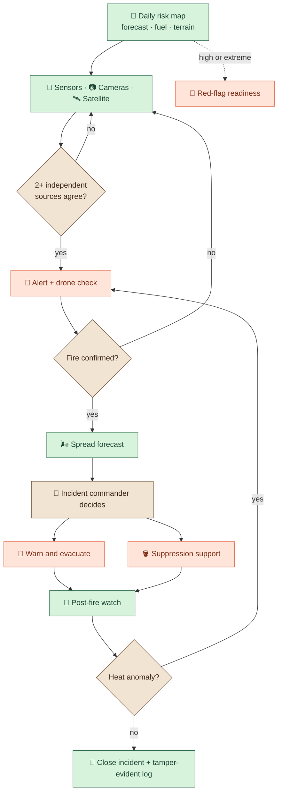

<div align="center">

```
        🌲  🌲🌲  🌳  🌲  🌲🌲  🌳  🌲
      🌿 🍃  🌿  🍃  🌿  🍃  🌿  🍃  🌿
```

# 🌲 Integrated Wildfire Intelligence System 🔥

### *Listen to the forest before it burns.*

**One platform to predict, detect, verify, respond to and watch over wildfires, built for Indian forests.**

<br/>


<br/>

[🌱 Concept](#-the-seed-concept) · [🌳 Architecture](#-the-canopy-how-it-works) · [🍂 Indian Cases](#-fallen-leaves-lessons-from-indian-forests) · [🌦️ Climate Fit](#%EF%B8%8F-weathering-the-seasons-fit-for-india) · [🗺️ Roadmap](#%EF%B8%8F-the-trail-plan-of-action) · [🤝 Contribute](#-join-the-grove)

</div>

---

## 🌱 The Seed: Concept

Most fire tools do one job. This project links five into a single chain, so a whisper of smoke in a valley becomes a verified alert, a spread forecast and a village warning before it becomes a disaster.

| | Stage | What it does |
|---|---|---|
| 🌦️ | **Predict** | Daily colour-coded fire-risk map on a 1 km grid: low, moderate, high, extreme |
| 👃 | **Detect** | Finds ignition early, including smouldering fires that show no flames yet |
| 🌬️ | **Project** | Forecasts spread from wind and terrain, with a cone of uncertainty |
| 📣 | **Respond** | Coordinates crews and warns communities in their own language |
| 🌿 | **Watch** | Keeps eyes on burned ground so fires do not rekindle |

> 🍃 **Principle:** AI proposes, people decide. The system never starts or authorises a burn, and evacuation or backfire advice always needs a qualified commander's sign-off.

---

## 🌳 The Canopy: How It Works



### 🌿 Layers at a glance

| Layer | Role | Built with |
|---|---|---|
| 🌦️ **Risk intelligence** | Daily risk grid | FSI Van Agni and NASA FIRMS fire history, IMD forecasts, Sentinel-2, terrain, scikit-learn (gradient-boosted trees or random forest), spatial cross-validation |
| 📡 **Detection** | Early, multi-source ignition alerts | Solar IoT nodes (temperature, humidity, PM2.5, CO, CH4, IR array) over LoRaWAN, tower cameras with a smoke CNN, satellite hotspots |
| 🚁 **Drone assessment** | Verifies fire and maps its perimeter | Thermal drones, AI-assisted spread-risk estimate, DGCA-compliant flights |
| 🌬️ **Wind and spread** | Time-to-impact for canopy and villages | Anemometers, USFS WindNinja, Rothermel-style raster simulation |
| 📣 **Alerting** | Reaches people even when networks fail | Cellular, LoRa mesh, satellite messenger, radio; cell broadcast, SMS, sirens, loudspeakers |
| 🧭 **Command dashboard** | One shared picture | PostGIS, FastAPI, MQTT or Kafka, MapLibre, offline tile cache |
| 🪣 **Suppression support** | Low-water firefighting | Soil/sand throwers, backpack blowers, advisory backfire planning |
| 🌿 **Post-fire watch** | Stops rekindling | Ground thermal and CO sensors, drone sweeps, logged mop-up checklist |

### 🔑 The golden rule of detection

> An alert needs **at least two independent sources** before a crew is sent. This filters noise from dust, haze and crop-residue smoke.

---

## 🍂 Fallen Leaves: Lessons from Indian Forests

Every case below shows the same pattern: small fires missed, weather turning fuel into hazard, and human ignition.

| 🌲 Forest | 📅 When | 🔥 What happened | 🌿 What this system changes |
|---|---|---|---|
| **Uttarakhand** (Himalayan pine and oak) | 2023-24 season | Satellites logged 21,033 fire counts versus 5,351 the season before; the state topped India's ranking | Terrain-aware spread, LoRa mesh where mobile signal fails, village-level alerts |
| **Similipal, Odisha** (sal and mixed deciduous) | Feb-Apr 2021 | Over 3,400 small fires; many were not put out early and merged into a major event; flare-ups returned in April | Early multi-source detection, post-fire watch, community partnership |
| **Bandipur and Nilgiris** (dry deciduous) | Feb 2019 | About 4,420 hectares burned (ISRO NRSC estimate), spreading across three states | Rain-then-drought fuel tracking, one cross-state dashboard, ignition-source watch |

> 🌾 **Reality check:** of 3,769 FSI alerts issued for Uttarakhand between 15 February and 25 May 2025, only 529 (14%) were actual forest fires, per the state forest minister. Verification is the gap this project targets.

> 🦌 Dry deciduous forests such as Bandipur evolved with fire. The goal is preventing *destructive* fire, not erasing all fire.

### 🏔️ Terrain zones

| Terrain | Fuel and behaviour | Adaptation |
|---|---|---|
| 🏔️ Himalayan | Pine litter, steep slopes, valley winds | WindNinja, slope-aware spread, satellite links, hand crews |
| 🌴 Eastern Ghats and east-central | Leaf litter, many small ground fires | Cluster detection, community alerts, drones |
| 🌿 Western Ghats and Nilgiris | Grass and lantana, rain-then-drought swings | Fuel-moisture risk layer, cross-state dashboard |
| 🌾 Central Indian dry forest | Dry litter, extreme summer heat | Heat-hardened sensors, village-edge watch |

---

## 🌦️ Weathering the Seasons: Fit for India

| 🌍 Condition | ⚠️ Challenge | 🌱 Design response |
|---|---|---|
| 🔥 Fire season (Nov to June) | Hardware must be live in time | Install and test by October |
| 🌧️ Monsoon | Rain and humidity; lush new fuel | Sealed IP67 nodes, solar with battery backup, post-monsoon risk update |
| ☀️ Heat above 45 °C | Sensor drift, battery stress | Industrial-grade parts, shaded mounts, baseline calibration |
| 🌫️ Dust and crop smoke | False smoke detections | Two-source rule, drone thermal check |
| ⛰️ Remote hills | No cellular, no roads | LoRaWAN (865-867 MHz licence-free), satellite messengers, radio |
| 🧑‍🌾 Human ignition | Grazing, farm burning, deliberate fires | Ignition-source watch, village engagement |
| 💧 Dry-season water scarcity | Little water for suppression | Soil/sand units, backpack blowers |
| 🗣️ Language | Alerts must be understood | Hindi and local-language voice and text alerts |

---

## 🗺️ The Trail: Plan of Action

```
 Phase 0 ──► Phase 1 ──► Phase 2 ──► Phase 3 ──► Phase 4 ──► Phase 5
 🌱 Prepare  🔨 Build    🌳 Install   🔥 Season    📊 Evaluate  🌲 Scale
 months 0-3  months 3-8  before Nov   Nov to June  post-monsoon year 2+
```

| Phase | What happens |
|---|---|
| 🌱 **0. Prepare** | Choose two pilot blocks (one Himalayan, one central or peninsular), sign agreements, check drone and spectrum permissions, consult villages |
| 🔨 **1. Build** | Train the risk model, build fusion engine, dashboard and alert routing, bench-test hardware, write local-language alerts |
| 🌳 **2. Install** | Deploy sensors, cameras and gateways; run drills; dry-run escalation |
| 🔥 **3. Fire season** | Run live and review monthly |
| 📊 **4. Evaluate** | Compare against FSI baseline, validate smouldering detection, decide go or no-go |
| 🌲 **5. Scale** | Extend by terrain type, add utility-asset and water-supply layers |

### 🌿 How we will measure success

- ⏱️ Time from ignition to confirmed detection
- 🎯 False-alarm rate against the FSI alert baseline
- 🚒 Time from alert to first crew on site
- 🔍 Smouldering or holdover fires caught before re-ignition
- 📣 Share of alerts acknowledged within the escalation window

---

## 🌲 Repository Layout *(planned)*

```
wildfire-intelligence/
├── 🌦️ risk/          # risk model, features, spatial cross-validation
├── 📡 detection/     # sensor ingest, camera CNN, satellite feeds, fusion rule
├── 🚁 drones/        # mission planning, thermal image analysis
├── 🌬️ spread/        # WindNinja wrapper, Rothermel-style simulation
├── 📣 alerts/        # routing, escalation, cell broadcast and SMS gateways
├── 🧭 dashboard/     # FastAPI backend, MapLibre front end
├── 🌿 postfire/      # burn-scar watch, mop-up checklist
├── 🍃 docs/          # proposal, case studies, field guides
└── 🧪 tests/
```

> 🪵 This layout is a proposal. Folders will be created as each phase lands.

### 🧰 Planned stack


---

## ⚖️ Safety and Ethics

- 🧭 **Human oversight.** Evacuation orders and backfire plans are advisory. A certified, authorised commander approves each one.
- 📜 **Law first.** Operations follow the Indian Forest Act, the Wildlife Protection Act and DGCA drone rules.
- 🔒 **Honest records.** Alerts, mop-up checks and decisions go to a tamper-evident log.
- 🤝 **Communities first.** Villages and forest committees are partners, not bystanders.
- 🔬 **Validate before trusting.** Gas-based detection of buried smouldering fires still needs field validation.

---

## 🤝 Join the Grove

Contributions are welcome, from forest officers, field staff, data scientists, embedded engineers and anyone who has fought a fire.

1. 🍴 Fork the repository
2. 🌱 Create a branch: `git checkout -b feature/your-idea`
3. 🌿 Commit your changes
4. 🌳 Open a pull request describing what you changed and why

Good first areas: fuel-moisture features, camera smoke-detection benchmarks, local-language alert templates, and field notes from your region.

---

## 📚 Sources and Acknowledgements

Case figures come from the Forest Survey of India (FSI), ISRO's National Remote Sensing Centre, state forest departments and reporting by Mongabay India, Scroll, Hindustan Times, The Tribune and others. The full source list is in the proposal document. Figures differ between sources and dates, so confirm official numbers before any formal submission.

Built on the shoulders of open tools: USFS WindNinja, NASA FIRMS, Sentinel-2, scikit-learn, PostGIS and MapLibre.

---

## 📄 License

Released under the **MIT License** *(placeholder: confirm the licence before publishing)*.

<div align="center">

<br/>

```
   🌲🌲🌳🌲🌲   Protect the forest. Protect the people who live in it.   🌲🌳🌲🌲🌲
```

</div>
